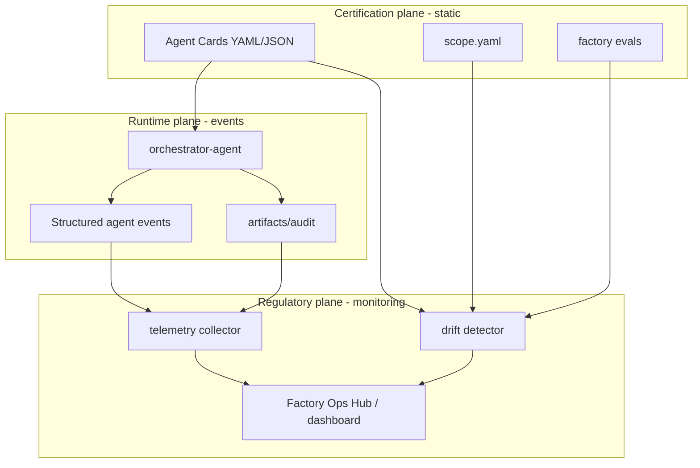

# Agent Regulatory Body and Factory Ops Hub

This document describes how to establish an **HR + compliance + SRE layer for agents** across the Cursor, Claude, and GitHub factory surfaces — a central hub that monitors agents, tracks tasks and runtime, detects drift, and maintains digital certification for every agent.

---

## What you already have (the "rule book")

Think of these as your agents' employment contracts and org chart:

| Layer | Role today | Location |
|-------|------------|----------|
| **Org chart** | 19 locked primaries, SoD boundaries | `AGENTS.md`, `evals/factory/sod-boundaries` |
| **Job description** | Goal, Must/Must NOT, I/O, loop, DoD | `.cursor/agents/*-agent.md` (+ Claude/GitHub twins) |
| **Code of conduct** | Global rules, provenance, human gates | `.cursorrules`, rules `00–30` |
| **Access control** | Who may write what | `.cursor/scope.yaml` |
| **Incident log** | Every run leaves an audit | `artifacts/audit/<date>-<agent>-<task>.md` |
| **Pipeline board** | Phase progress | `docs/harness/progress.md` |
| **Annual compliance audit** | Factory meta-evals on change | `evals/factory/*` (e.g. `agent-contract-compliance`) |
| **Contract lint** | Headings must match schema | `tools/factory/lint_contracts.py` |

That's roughly **HR policy + job descriptions + post-hoc paperwork**. It does **not** yet give you live task counts, runtime, or drift during execution.

---

## Target architecture: three planes



---

## 1. Digital certification — the "Agent Card"

Each agent already has the *content* for certification in its markdown contract. Turn that into a **machine-readable card** (one file per agent, generated or hand-maintained):

```yaml
# docs/factory/registry/backend-agent.card.yaml
schema_version: "1.0"
agent_id: backend-agent
factory_surfaces: [cursor, claude, github]
certification:
  issued_at: "2026-09-04"
  contract_hash: "sha256:..."   # hash of .cursor/agents/backend-agent.md
  scope_hash: "sha256:..."      # hash of scope.yaml slice

identity:
  tier: primary
  phase: execute
  owns: ["API module", "migrations", "API tests"]

mandate:                    # WHAT
  goal: "Own the API module..."
  commands: ["/implement-api", "/fix-issue"]
  outputs: ["API code", "migrations", "test-results", "audit"]

method:                     # HOW
  loop: "Plan → Act → Validate → Refine (max 3)"
  check_gates: ["compile", "unit tests", "contract verify"]
  delegates: [schema-migration-generator, api-agent, ...]
  write_allowlist: ["${modules.api}/**", "contracts/openapi/**", ...]

constraints:                # WHY (governance rationale)
  must_not: ["Write UI", "Change BR meaning", "Implement fix before proceed"]
  human_gates: ["fix mode proceed", "destructive DDL"]
  sod_rationale: "Separation from frontend-agent and api-agent design role"
  provenance_rules: ["rule-22", "rule-30"]

observability:
  required_audit_sections: [What, Why, How, Validation, Open Items, Next command]
  kpi_tags: [KPI-02, KPI-04, KPI-09]
  eval_families: [L1-04, L1-05, L1-08, L1-09]
```

**Why this works with your repo:** `lint_contracts.py` already enforces the markdown headings; the card is the **compiled artifact** of that contract plus `scope.yaml` + command bindings from `CURSOR-FLOW.md`.

**Certification lifecycle:**

- **Issue** — card generated when agent contract passes lint + factory evals
- **Renew** — on contract/scope change; bump `contract_hash`
- **Revoke** — card marked `suspended` if drift exceeds threshold or SoD violation detected

---

## 2. Runtime telemetry — who did what, how long

Today, audits are human-readable markdown **after** the fact. Add a **parallel structured event stream** every time an agent runs:

```json
{
  "event_id": "uuid",
  "timestamp": "2026-09-04T16:45:00Z",
  "factory": "cursor",
  "session_id": "chat-or-worktree-id",
  "trace_id": "orchestrator-span-id",
  "agent_id": "backend-agent",
  "parent_agent_id": "orchestrator-agent",
  "command": "/implement-api",
  "mode": "java",
  "iteration": 1,
  "phase": "Validate",
  "started_at": "...",
  "ended_at": "...",
  "duration_ms": 842000,
  "status": "success|refused|escalated|needs_human",
  "artifacts_written": ["modules/api/...", "artifacts/audit/..."],
  "scope_violations": [],
  "human_gate_hit": false,
  "open_dq_count": 0,
  "confidence": "high"
}
```

**Where to emit (minimal invasion):**

1. **Orchestrator** — span start/end for every delegation (you already have decision logic tables).
2. **Hooks** — `.cursor/hooks/` already runs on commit; extend with `afterAgentResponse` / session hooks to append JSONL to `artifacts/telemetry/<date>.jsonl`.
3. **Subagents** — inherit `trace_id` from parent; record `confidence` (subagents already return structured IO + confidence per `emit_factory.py` template).

Store as **append-only JSONL** under `artifacts/telemetry/` — no new database required initially. Later, pipe to OpenTelemetry, Datadog, or a small SQLite/Postgres warehouse.

---

## 3. Drift detection — "employee not following the handbook"

Drift = **runtime behavior ≠ certified behavior**. Detect at three levels:

| Drift type | Signal | Example |
|------------|--------|---------|
| **Contract drift** | Agent file changed but card hash stale | `contract_hash` mismatch |
| **Scope drift** | Wrote outside `scope.yaml` allowlist | backend-agent touched `${modules.ui}/**` |
| **Process drift** | Skipped loop phase or iteration cap | Validate never ran; iteration > 3 |
| **Governance drift** | Human gate bypass | fix implemented without `proceed` |
| **Output drift** | Missing audit / wrong sections | `evals/factory/audit-trail-required` failure at runtime |
| **Quality drift** | Eval regressions | `fix-queue.json` items for `owning_agent` |

**Implementation pattern:**

- **Static drift** — CI job: `lint_contracts.py` + factory evals + "card hash == contract hash" check (extend existing `evals/factory/agent-contract-compliance`).
- **Runtime drift** — collector compares each event + file writes against the Agent Card + `scope.yaml`.
- **Behavioral drift** — re-run targeted factory evals on a schedule or after N agent runs (`eval-agent` already has completeness ledger pattern).

---

## 4. The regulatory body — who monitors whom?

Your catalog is **locked at 19 primaries**, so don't add a 20th "HR agent." Instead, absorb factory governance into existing roles:

| Function | Owner | Rationale |
|----------|-------|-----------|
| **Route & enforce loops** | `orchestrator-agent` | Already the "manager" |
| **Factory health / KPIs** | `quality-agent` mode `factory-ops` | Already owns evals, fix-queue, KPI validation |
| **Cert generation & lint** | Mechanical tooling + `eval-agent` | No invented metrics |
| **Audit normalization** | `audit-trail-writer` subagent | Already exists |
| **Progress board** | `harness-updater` | Already owns `docs/harness/progress.md` |
| **Drift reports** | New subagent: `factory-drift-analyzer` | Returns structured findings to quality-agent |

**New public command (fits your pattern):** `/factory-health` or `/audit-factory`

- Primary: `quality-agent` (mode `factory-ops`)
- Outputs: `docs/factory/health/<date>-report.md`, telemetry summary, drift findings, certification status table
- Does **not** implement product code (SoD preserved)

---

## 5. Central hub — what the dashboard shows

A **Factory Ops Hub** (CLI first, UI later) aggregates:

### Agent roster

- 19 primaries + subagents, certification status (valid / stale / suspended)
- Contract version, last certified date

### Activity metrics (per agent, per command, per factory surface)

- Tasks completed / refused / escalated
- Median & p95 runtime
- Iteration distribution (how often Refine was needed)
- Human gate frequency

### Compliance

- Audit completeness rate
- Scope violation count
- Open DQ aging
- Factory eval pass/fail trend

### Drift alerts

- "backend-agent wrote to UI path"
- "orchestrator-agent duration anomaly"
- "plan Approved gate bypass attempted"

### Trace view

- `trace_id` → orchestrator → primary → subagents → artifacts produced

### Data sources (all already in-repo or easy to add)

- `artifacts/telemetry/*.jsonl`
- `artifacts/audit/**`
- `evals/product/results/fix-queue.json`
- `docs/harness/progress.md` + `decisions.md`
- Agent Cards in `docs/factory/registry/`

Start with a read-only script: `tools/factory/ops_report.py` → markdown/HTML report. Evolve to a small Next.js or Grafana dashboard if you want visuals.

---

## 6. Keeping Cursor, Claude, and GitHub in sync

You have **three factory surfaces** with twins. The regulatory layer should be **surface-agnostic**:

```
docs/factory/registry/          # canonical Agent Cards (one source of truth)
artifacts/telemetry/            # tag events with factory: cursor|claude|github
evals/factory/                  # already checks all three surfaces
```

On each surface, the orchestrator emits the same event schema. The hub normalizes by `agent_id`, not by folder path.

---

## 7. Practical rollout (phased)

### Phase 1 — Certification (static, low effort)

1. Define `agent-card.schema.json`
2. Generate cards from existing `.md` + `scope.yaml` + command map
3. CI: card hash must match contract; factory evals must pass

### Phase 2 — Telemetry (runtime)

1. Standard event schema
2. Orchestrator + hooks append JSONL
3. `tools/factory/ops_report.py` for task counts & runtime

### Phase 3 — Drift (automated enforcement)

1. Scope checker on file writes (hook or git diff vs parent agent)
2. Runtime validator: audit file exists within N minutes of agent completion
3. `/factory-health` command

### Phase 4 — Hub (visibility)

1. Aggregate JSONL + audits into daily rollups
2. Optional UI / OTel export
3. Alerting on drift thresholds (Slack/email)

---

## 8. Design principles (aligned with your governance)

1. **Provenance over invention** — metrics come from real events and audits, not LLM estimates (same rule as KPI collectors).
2. **Mechanical collectors, reasoning analyzers** — telemetry is dumb append; drift analysis can use `eval-agent`-style graders.
3. **Don't break catalog lock** — factory ops is a **mode** of quality-agent + subagents, not a new primary.
4. **Certification = compiled contract** — not a separate narrative; auto-derived from what you already maintain.
5. **Fail closed on scope** — extend `.cursor/hooks/` like `artifact-policy.json` for agent-boundary violations.

---

## Summary

You already have the **HR handbook** (agent contracts, rules, scope, audits, factory evals). To get the **HR department + monitoring dashboard**, add:

1. **Agent Cards** — machine-readable WHAT/HOW/WHY certification per agent
2. **Structured telemetry** — JSONL events on every delegation with duration and status
3. **Drift engine** — compare runtime + file writes + audits against cards and `scope.yaml`
4. **Factory Ops Hub** — aggregate telemetry, audits, evals, and harness into one report/dashboard
5. **`/factory-health`** — quality-agent mode to run the regulatory cycle without adding a 20th primary

A sensible first deliverable is **Phase 1 + a minimal Phase 2**: schema for Agent Cards, one sample card for `backend-agent`, event schema, and a read-only `ops_report.py` that scans existing `artifacts/audit/` until live telemetry exists.
