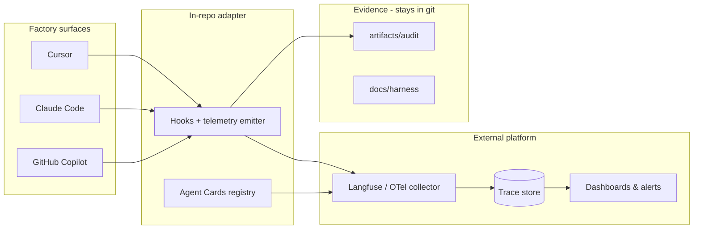

# External Platform Observability for the AI Factory

Yes — and for real **track / monitor / observe** at scale, an external platform is the right direction. Markdown and `artifacts/audit/` should stay as your **governance evidence layer**; the external system should be the **live control plane**.

Right now the factory is strong on static governance (contracts, scope, audits, evals) but has **no runtime telemetry pipeline** — only a design note in your doc about OTel/Datadog later.

## Recommended model: hybrid, not either/or

| Layer | Where it lives | Purpose |
|-------|----------------|---------|
| **Contracts & certification** | In-repo (`Agent Cards`, `scope.yaml`, agent `.md`) | Source of truth for WHAT/HOW/WHY |
| **Evidence / audit trail** | In-repo (`artifacts/audit/`) | Compliance, traceability, PR evidence |
| **Live telemetry** | External platform | Traces, metrics, dashboards, alerts |
| **Drift rules** | In-repo definitions; evaluated externally or in CI | Compare runtime vs certification |

Markdown alone cannot give you p95 latency, fleet-wide task counts, or alerting. An external platform cannot replace your provenance rules or human gates. You want both.

---

## What an external platform can give you

- **Real-time dashboards** — tasks per agent, success/refusal/escalation rates, duration, cost/tokens
- **Distributed tracing** — `orchestrator → backend-agent → api-agent → subagents`
- **Alerting** — scope violation, missing audit, iteration > 3, human gate bypass attempt
- **Search & drill-down** — filter by command, sprint, factory surface, agent_id
- **Long-term storage** — retention beyond git artifact size limits
- **Cross-team visibility** — PM, security, SRE see factory health without opening the repo

---

## Platform categories (pick by primary need)

### 1. Agent / LLM observability (best fit for your use case)

Built for traces, spans, tool calls, evals, and agent workflows:

| Platform | Strengths | Fit for your factory |
|----------|-----------|----------------------|
| **[Langfuse](https://langfuse.com)** | Open-source option, traces, scores, datasets, self-host | Strong — map each agent delegation to a span |
| **[LangSmith](https://smith.langchain.com)** | Traces, evals, datasets | Strong if you standardize on LangChain-style instrumentation |
| **[Arize Phoenix](https://arize.com/docs/phoenix)** | Traces, evals, drift on LLM outputs | Good for quality + behavioral drift |
| **[Braintrust](https://braintrust.dev)** | Evals + production logging | Good if eval-agent results feed scores |
| **[Helicone](https://helicone.ai)** | Proxy-based LLM logging | Easy start; less rich for multi-agent SoD |
| **Weights & Biases Weave** | Experiment + trace tracking | Good for factory eval runs |

These map naturally to your event schema (`agent_id`, `command`, `iteration`, `phase`, `status`, `confidence`).

### 2. General observability (APM / OpenTelemetry)

| Platform | When to use |
|----------|-------------|
| **Datadog / Grafana Cloud / New Relic / Honeycomb** | You already have enterprise APM; want one pane for app + factory |
| **Jaeger + Prometheus + Grafana (self-hosted)** | Full control, no SaaS |

Use **OpenTelemetry (OTLP)** as the export format so Cursor/Claude/GitHub all emit the same spans to one backend.

### 3. Workflow / orchestration platforms

| Platform | Role |
|----------|------|
| **Temporal / Prefect / Airflow** | Durable multi-step pipelines — overkill for chat-driven agents unless you move to scheduled factory jobs |
| **Custom dashboard (Supabase + Next.js / Retool)** | Factory Ops Hub UI on top of your own event store |

---

## How to connect your three factories to an external system

Your surfaces (Cursor, Claude, GitHub) don't share one native telemetry API. The integration pattern is a **thin adapter** that emits a standard event schema:

```
Agent run (any surface)
    ↓
Hook / wrapper / post-command script
    ↓
Factory Telemetry Adapter (small Node/Python service or hook)
    ↓
OTLP / HTTP webhook → External platform
    ↓
Dashboard + alerts
```

**Integration points you already have or can extend:**

1. **Cursor hooks** — `.cursor/hooks/` (`beforeSubmitPrompt`, `beforeShellExecution`); extend to emit span start/end on slash commands
2. **Claude hooks** — `.claude/hooks/` (same pattern, plus `provenance-guard`, `secret-guard`)
3. **Orchestrator contract** — instruct orchestrator to log structured JSON at delegate boundaries (works on all surfaces via prompt contract)
4. **CI** — factory evals + card-hash checks → push results to platform as batch "compliance runs"
5. **Git hooks** — `tools/check-artifacts.mjs` → emit scope/audit compliance events on commit

**Critical fields to send (aligned with your doc):**

```json
{
  "factory": "cursor|claude|github",
  "trace_id": "...",
  "agent_id": "backend-agent",
  "command": "/implement-api",
  "duration_ms": 842000,
  "status": "success|refused|escalated",
  "scope_violations": [],
  "human_gate_hit": false,
  "contract_hash": "sha256:..."
}
```

Tag every span with `repo`, `sprint`, `session_id`, and `factory` so the hub normalizes across surfaces.

---

## What to track externally vs keep in markdown

| Keep in-repo | Send to external platform |
|--------------|---------------------------|
| Agent contracts & Agent Cards | Span/traces per delegation |
| `artifacts/audit/*.md` (evidence) | Metrics: count, duration, status |
| `docs/harness/progress.md` | Alerts on gate bypass / drift |
| Factory eval definitions | Eval pass/fail time series |
| `scope.yaml` rules | Scope violation events (from hooks/git diff) |
| Human gate decisions in `decisions.md` | Human gate hit frequency |

Audits remain the **legal/audit record**; the platform is the **operational nervous system**.

---

## Drift detection on an external platform

Your doc defines drift types (contract, scope, process, governance, output, quality). Externally:

1. **Contract drift** — CI compares Agent Card hash to live `.md`; result pushed as compliance metric
2. **Scope drift** — hook compares file writes to `scope.yaml`; emit violation span
3. **Process drift** — trace shows missing `Validate` phase or `iteration > 3`
4. **Governance drift** — event where `/fix-issue` reached `Act` without `human_gate_hit: true` on proceed
5. **Quality drift** — ingest `evals/product/results/fix-queue.json` as scored runs in Langfuse/Braintrust

Platforms like Langfuse and Arize support **custom scores** — map factory evals to scores per agent (`backend-agent: L1-08 = fail`).

---

## Practical architecture (enterprise-friendly)



**Suggested stack (balanced cost vs capability):**

- **Traces + agent dashboard:** Langfuse (cloud or self-hosted)
- **Enterprise APM (if required):** OTel → Datadog/Grafana
- **Alerts:** Platform native → Slack/PagerDuty
- **Factory Ops report:** `/factory-health` still writes markdown summary; links to external trace URLs

---

## Constraints from your factory governance

1. **No secrets in telemetry** — mask PII/PHI; never ship prompts with credentials (rule 02)
2. **Provenance over invention** — metrics from real events, not LLM-estimated counts (same as KPI collectors)
3. **Catalog lock** — observability is a **quality-agent mode** + hooks/tooling, not a 20th primary
4. **Three-surface parity** — one OTLP schema, three emitters
5. **Fail closed** — scope violations should alert, not silently log

---

## Rollout path (external-first)

1. **Choose platform** — Langfuse or OTel→Grafana for most teams; Datadog if already standard
2. **Define OTLP/event schema** — same as your doc's JSON event model
3. **Add hook emitter** — append to local JSONL *and* POST to platform (dual-write during migration)
4. **Register Agent Cards** — platform metadata / tags per `agent_id`
5. **Dashboards** — tasks by agent, refusal rate, p95 duration, drift alerts
6. **CI compliance feed** — factory evals + card hash → nightly compliance dashboard
7. **Retire markdown-only reporting** for ops metrics; keep audits for evidence

---

## Bottom line

Yes — you should use an **external observability platform** for tracking, monitoring, and live observation. Markdown and audits remain essential for **governance and evidence**, not for **operational visibility**.

The missing piece in the repo today is not the platform choice — it's a **standard telemetry adapter** (hooks + event schema + OTLP export) that all three factory surfaces emit to. Once that exists, Langfuse, Datadog, Grafana, or a custom hub can become your real "HR monitoring system."

A sensible first deliverable is scaffolding the event schema, hook emitter, and a Langfuse/OTel integration plan without breaking catalog lock.
