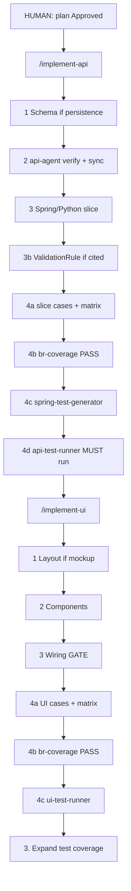

# 2. Implement API and implement UI

Validated against: `/implement-api`, `/implement-ui`, `/deliver-sprint`, `/apply-requirements`, ASSUMPTION-PCC-002.

Product build for one **Approved** plan row. Slice tests run here. Remaining FR/BR gap scripts wait for [03-test-cases-and-execution.md](03-test-cases-and-execution.md). Expand coverage PASS does **not** block implement.

## Where it starts

Plan status must be **Approved**. **Proposed — Pending Approval** → orchestrator refuses.

```
HUMAN: plan Approved
  → /implement-api
  → /implement-ui          (skip if plan marks UI N/A)
  → /expand-test-coverage  (phase 3)
```

Batch: `/deliver-sprint` runs that order, then **STOP** after expand Pending Approval.

There is no public `/generate-backend`, `/generate-frontend`, or `/wire-*`. Wiring is a required gate inside `/implement-ui`.



**Loop on both commands:** Plan → Act → Validate → Refine (max 3). Iteration 1 Validate pass → stop.

---

## `/implement-api` — every step

**Primaries:** backend-agent + api-agent. **data-agent** if schema changes.

Required: Approved plan or SP item; `implementation_module_root` (or resolved from governed plan). Optional: `@governed_plan`, `plan_step`.

If a governed plan is supplied, load plan-as-input protocol **before** asking questions. Resolve bindings from the plan. Register Open DQ for TBD; do not invent. Destructive DDL needs quoted story AC.

| # | Step | Who | What | Stop / fail |
|---|------|-----|------|-------------|
| 0 | Gate | orchestrator | Plan **Approved**? | Refuse if Proposed |
| 1 | Schema | data-agent / schema-migration-generator | Additive Flyway/Liquibase + JPA when tables/columns/indexes/seeds change | No silent DROP |
| 2a | Contract design | api-agent gate 1 | OpenAPI only if endpoints/DTOs/status codes change | Do not redesign silently |
| 2b | Contract verify | api-agent gate 2 | **Every run** starts with verify | Gate 2 is not optional |
| 3 | Slice | backend-agent + spring-module-generator | Java from `java_master_templates/` (or Python per config) | Extract vars to `artifacts/templates/<resource>-vars.yaml`; `# AMBIGUITY` → stop |
| 3chk | Render | backend-agent | `python3 tools/templates/render_check.py --vars <yaml> --check both` | Template-owned drift = FAIL; do not rewrite controller style |
| 3b | Validation | validation-chain-generator | Only if cited validation BRs changed | |
| 4a | Cases | test-case-generator | `docs/test-cases.md` + `docs/test-matrix.md` for **this SP** | Full bodies; cite FR/BR/AC |
| 4b | Coverage | quality-agent → br-coverage-validator | Only writer of `docs/test-cases-br-coverage.md` | FAIL → expand cases; **no scripts** |
| 4c | Scripts | spring-test-generator | `java_test_templates/`; agent-owned extras are sibling classes citing case IDs | After PASS only |
| 4d | Execute | api-test-runner | Tests **must** run | `artifacts/test-results-<date>.md` |
| 5 | Audit | backend-agent | `artifacts/audit/<date>-implement-api-<task>.md`; harness-updater | No UI files written |

**Must NOT:** change BR meaning without confirmation; swallow frontend work; leave `scope.yaml`.

**DoD extras:** contract verify recorded; render_check PASS; no UI files.

**Next:** `/implement-ui` if the item has UI; otherwise `/expand-test-coverage`.

---

## `/implement-ui` — every step

**Primary:** frontend-agent.

Required: Approved plan or SP item. Optional: `mockup_path`, Figma **node screenshot** (not DS URL), `@governed_plan`.

If neither mockup, Figma sketch, UX spec, nor story UI table exists → Open DQ. Do not invent copy or API fields.

| # | Step | Who | What | Stop / fail |
|---|------|-----|------|-------------|
| 0 | Gate | orchestrator | Plan **Approved** | Refuse if Proposed |
| 1 | Layout | mockup-to-component | If mockup/sketch from phase 1 | Whiteboard/flowchart is **not** a page — use whiteboard skill |
| 2 | Components | frontend-agent + next-component-generator | Pages/components | Stay in UI `scope.yaml` |
| 3 | Wiring **gate** | frontend-agent | Typed client, ordered sequence, traceability | Required. Not a public `/wire-*` |
| 4a | Cases | test-case-generator + e2e-scenario-writer if journey changed | Slice cases + matrix | |
| 4b | Coverage | br-coverage-validator | PASS before runners | FAIL → expand cases; do not run |
| 4c | Execute | ui-test-runner | `npm test` or equivalent; E2E if journey changed | Playwright skill when E2E |
| 5 | Audit | frontend-agent | `artifacts/audit/<date>-implement-ui-<task>.md`; harness | Do not write API business logic |

Figma **file URL** DS work is `/figma-to-nextjs` (phase 1), then this command wires it into the product.

**Next:** `/expand-test-coverage`.

---

## `/deliver-sprint` — batch wrapper

Orchestrator **does not write product code**. Required: Approved sprint or unified governed plan.

| # | Child | Notes |
|---|-------|--------|
| 1 | `/implement-api` | Skip only if plan row N/A |
| 2 | `/implement-ui` | Skip only if plan row N/A (API-only) |
| 3 | `/expand-test-coverage` | Then **STOP** until test-package **Approved** |
| 4 | `/run-tests` | After human Approved (or waiver) |
| 5 | `/run-eval` | Inner `/close-eval-gaps` if auto_fix |
| 6 | `/review-changes` | |
| 7 | `/application-summary` | |

Parallel slices must not edit shared files (`parallel-agent-file-ownership.md`).

Paused next: human sets `docs/quality/test-package-review.md` Approved, then `/run-tests` or resume `/deliver-sprint`. Finished next: `/pr-assist`.

---

## `/apply-requirements` — surgical (not a third spine)

Cited BR / wiki / story IDs only. change-agent mode `cited` + backend or frontend per touch.

1. Change plan with provenance.
2. Diffs limited to cited rules (uncited = out of scope).
3. Cases + matrix for cited rules.
4. br-coverage-validator PASS (`pre-script` then `post-change`).
5. Run tests for touched rules. Java: vars YAML + `render_check.py`.
6. **No** second human test-package gate on surgical apply.

**Next:** `/review-changes` if cited rules are covered; `/expand-test-coverage` if remaining FR/BR gaps. Review needs a `/run-eval` ledger — run `/run-eval` first if none exists. Ad-hoc bugs → [05-fix-issue.md](05-fix-issue.md).

---

## Agent vs human gates here

| Gate | Type |
|------|------|
| Plan **Approved** | **Human** |
| Destructive DDL / BR interpretation / breaking API | **Human** |
| Slice `docs/test-cases-br-coverage.md` PASS | Agent (validator only) |
| `render_check.py` PASS | Agent |
| Expand package Approved | Not this phase |

**Next phase:** [03-test-cases-and-execution.md](03-test-cases-and-execution.md).
