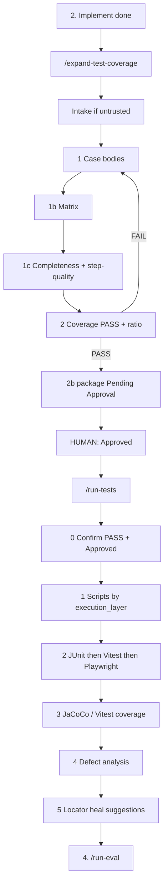

# 3. Test case write and execution

Validated against: `/expand-test-coverage`, `/run-tests`, rule 07, `br-tc-taxonomy.md`, `generic-step-denylist.md`, `ooda-self-heal-loop.md` (Phase 5 inner).

Two public commands:

1. **Design** — `/expand-test-coverage` (stops for a human)
2. **Scripts + run** — `/run-tests` (only after that human gate)

Implement already ran **slice** tests. This phase closes remaining FR/BR.

## Where it starts

After `/implement-ui` (or `/implement-api` when there is no UI). `/deliver-sprint` **stops** after expand Pending Approval.

Required for expand: `evals.rule_source` (Accepted BRD or story pack). Missing → refuse.

**Loop:** Plan → Act → Validate → Refine (max 3).

---

## `/expand-test-coverage` — every step

Optional: `--stop-after=design` completes after 1c; skips 2–2b.

**Primaries:** quality-agent coordinates; test-agent generate mode is **design only**.

**Out of scope:** UAT catalog (`docs/test/manual/**`), JUnit/Vitest/Playwright, suite runs, eval-agent, `/close-eval-gaps`. Heuristic bulk generators are forbidden.

### Intake (only if untrusted inputs: Figma extract, Excel, CSV)

| # | Step | Who | What |
|---|------|-----|------|
| I1 | Classify sources | test-intake-normalizer | Trusted BRD/stories/OpenAPI/checklists = scan skipped |
| I2 | Convert Excel | | `.xlsx` → CSV in `artifacts/test-intake/` then scan CSV |
| I3 | Scan | `scripts/intake-safety-scan.py` | Exit 2 block; exit 1 PII halt; exit 0 clean |
| I4 | Manifest | | `artifacts/test-intake/<date>-manifest.json` (only when this intake ran) |

### Phase 1 — case bodies

| # | Step | Who | What |
|---|------|-----|------|
| 1.1 | Diff | quality-agent | Remaining FR/BR vs existing `docs/test-cases.md` |
| 1.2 | Taxonomy | automation-companion-author / test-case-generator | Classify Type **before** negatives (`br-tc-taxonomy.md`) |
| 1.3 | Author bodies | | Full numbered steps + expected; ≥2 concrete route/action/API steps |
| 1.4 | Layers | | `execution_layer` ∈ {api, IT, uat, integration, blocked} |
| 1.5 | Gherkin | bdd-scenario-expander | Only if Gherkin is in scope |
| 1.6 | Persist | | `docs/test-cases.md` |

Constraint negatives cite the BR’s **exact** error code + field. Behavioral-assertion BRs get **no** failure-path negative. Blocked BRs are documentation, not a happy path.

### Phase 1b — matrix

| # | Step | Who | What |
|---|------|-----|------|
| 1b.1 | Map | tc-traceability-mapper | FR/BR ↔ case_id ↔ story ↔ automated test |
| 1b.2 | Gaps | | `NONE — gap for expand-test-coverage` vs `NONE (Blocked)` |
| 1b.3 | Persist | | `docs/test-matrix.md` (index, not a substitute for bodies) |

### Phase 1c — quality validators (both must PASS)

| # | Check | Who |
|---|-------|-----|
| 1c.1 | Every FR/BR has a case or Blocked+owner; index matches bodies; negatives per taxonomy | tc-completeness-validator |
| 1c.2 | Zero denylist phrases; error-code specificity; step specificity | tc-step-quality-validator |
| 1c.3 | Metrics table in expand audit | quality-agent |

FAIL → re-delegate author (counts toward max 3). Silence on quality = FAIL.

If `--stop-after=design`: **stop here**. Resume later for phases 2–2b.

### Phase 2 — coverage gate

| # | Step | Who | What |
|---|------|-----|------|
| 2.1 | Score | br-coverage-validator only | `docs/test-cases-br-coverage.md` + **coverage ratio** |
| 2.2 | FAIL | | Stay in expand; **do not** write Pending Approval; **no** `/run-tests` |
| 2.3 | PASS | | Continue to 2b |

Implementers must not stamp PASS.

### Phase 2b — human package

quality-agent writes `docs/quality/test-package-review.md` with **Pending Approval** only (checklist, coverage path, ratio). Approver name/date left blank.

**Human gate:** human sets **Approved**. Agents Must NOT.

Audit: `artifacts/audit/<date>-expand-test-coverage-<task>.md` (includes intake + companion-quality). Harness updated. Confirm scripts/eval were **not** performed.

**Next:** `/run-tests` after Approved. After `--stop-after=design`: rerun expand for phases 2–2b.

---

## `/run-tests` — every step

**Refuse** if Approval missing, Pending, or agent-stamped. Only override: dated waiver in `docs/harness/decisions.md`. Coverage not PASS → return to `/expand-test-coverage`.

Required: coverage PASS, package Approved, `docs/test-cases.md`, `docs/test-matrix.md`.

### Phase 0 — gate

Orchestrator confirms PASS + Approved. STOP if unmet.

### Phase 1 — generate scripts (by `execution_layer`)

Do not invent journeys or AC not in the approved package.

| `execution_layer` | Gap `Automated = NONE` routes to |
|-------------------|----------------------------------|
| `api`, `IT` | backend-agent + spring-test-generator (JUnit/IT) |
| `uat` | frontend-agent (Vitest) and/or playwright-codegen (E2E) |
| `integration` | backend + frontend + playwright-codegen |
| `blocked` | Skip (not a gap); optional unit only |

Playwright-codegen **must** create `e2e/fixtures` + `e2e/data` if missing — do not no-op because a smoke spec exists. Specs cite case / AC / FR/BR. Prefer `getByRole` / `getByTestId`. Default `--workers=1`. Java: `render_check.py` PASS; agent-owned extras cite case IDs. No secrets in fixtures.

### Phase 2 — execute (order is locked)

1. api-test-runner (JUnit/IT)
2. ui-test-runner Vitest
3. Playwright E2E

If API is down for E2E: record **environment FAIL**. Do not skip journeys as pass.

Persist `artifacts/test-results-<date>.md` (commands, pass/fail/skip, script paths).

### Phase 3 — line coverage

coverage-analyzer: JaCoCo % for API and Vitest coverage for UI helpers when those layers ran. Do not disable JaCoCo or edit `pom.xml` floors.

### Phase 4 — defect analysis

e2e-defect-analyzer: one section per failed JUnit/Vitest/Playwright in `artifacts/issues/<date>-e2e-failure.md` (summary, likely root cause, confidence, suggested resolution, owning agent). Zero failures → N/A in test-results. Mask PII.

### Phase 5 — locator self-heal (OODA, suggestions only)

`playwright-self-healer` uses Observe → Orient → Decide → Act (`ooda-self-heal-loop.md`). Locator / strict-mode / timeout-on-selector only. Write `artifacts/issues/<date>-locator-heal.md`. **Do not merge.** Applying a heal needs an explicit human request. After apply, the next Observe is a new `/run-tests` run — do not inner-loop into apply. Max 3 is suggestion-quality only.

Not a factory-wide loop. `e2e-defect-analyzer` stays a single pass.

Audit: `artifacts/audit/<date>-run-tests-<task>.md`. Harness updated.

**Next:** `/run-eval`.

---

## Agent vs human gates

| Gate | Type |
|------|------|
| Completeness + step-quality | Agent |
| Coverage PASS + ratio | Agent (validator only) |
| Test-package **Approved** | **Human** |
| Apply locator heal | **Human** |

**Next phase:** [04-eval-review-and-summary.md](04-eval-review-and-summary.md).
