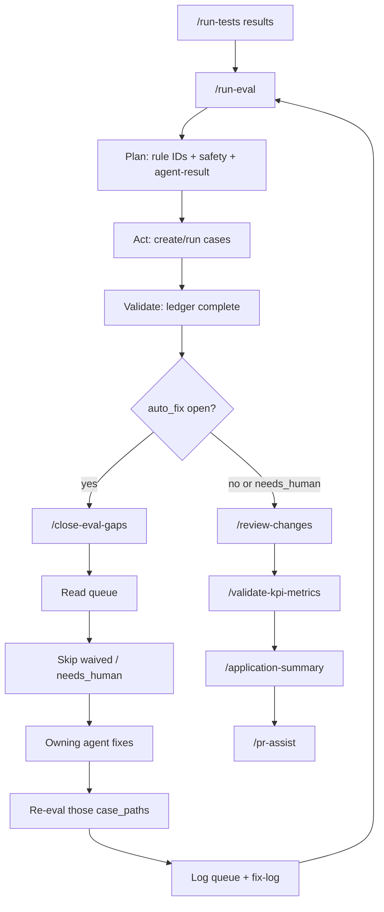

# 4. Evals, close-eval-gaps, review, and application summary

Validated against: `/run-eval`, `/close-eval-gaps`, `/review-changes`, `/validate-kpi-metrics`, `/application-summary`, eval-agent, eval-suite skill.

Eval-agent runs **only** via `/run-eval`. Expand and review do **not** invoke it.

## Where it starts

After `/run-tests` results exist (`artifacts/test-results-*.md`). Incremental mode refuses (or records Open DQ) if results are missing. Full-sweep may proceed with a documented waiver.

```
/run-eval
  → /close-eval-gaps     (inner, if auto_fix: true items are open)
  → /review-changes
  → /validate-kpi-metrics
  → /application-summary
  → /pr-assist
```



**Loop on each public command:** Plan → Act → Validate → Refine (max 3).

---

## `/run-eval` — every step

**Primary:** quality-agent → eval-agent.

Required: `evals.rule_source` in config. Missing → refuse.

| Mode | Invocation | Scope |
|------|------------|--------|
| incremental (default) | `/run-eval` | Sprint FR/BR ∪ always-on safety ∪ agent-result families |
| full-sweep | `/run-eval --mode=full-sweep` | L1-10 + L4-* + LX-* + agent-result |

Always-on safety (never dropped): L1-04, L1-05, L1-08, L1-09, L4-03.

Agent-result rows (never dropped): TCG completeness, coverage-gate honesty, `/run-tests` vs matrix, Playwright citations, intake-scan (if untrusted inputs were used), defect-analysis completeness, coding gaps.

| # | Step | Who | What |
|---|------|-----|------|
| 1 | Plan | eval-agent | Extract every `rule_id` from rule_source; diff STATUS.md; list NEW / MISSING / regressions; copy cited security P0/P1 as `imported_finding` — do not invent vulns |
| 2a | Create | eval-agent | Pointer or three-file cases under `evals/product/wave-1/<family>/cases/`. Safety families need positive **and** mandatory-negative (or pointers) |
| 2b | Run | eval-agent | Reuse `evals.test_commands` in config. Never invent a runner. Run every ledger row |
| 3 | Validate | eval-agent / quality-agent | Completeness ledger present; no family green with zero cases; P0/P1 not skipped; sanity (broken grader) ≠ verdict (product failed) |
| 4 | Refine | `/close-eval-gaps` | Only if `auto_fix: true` remains open; then re-eval those `case_path`s |

Refuse complete without `evals/product/results/<date>-completeness-ledger.md`. Cannot waive P0/P1. Cannot disable JaCoCo.

**Outputs:** incremental or full-sweep md+json, completeness ledger, `fix-queue.json`, `fix-log.md`, `artifacts/audit/<date>-run-eval-<task>.md`.

**Next:** `/review-changes` when ledger is complete and auto_fix is empty or `needs_human`. If `needs_human` remains: wait, then re-run `/close-eval-gaps` / `/run-eval`.

---

## `/close-eval-gaps` — inner loop (every hop)

Parent is `/run-eval` only. Required: `evals/product/results/<date>-fix-queue.json`. Missing → refuse. Do not invent queue items.

| # | Step | Who | What |
|---|------|-----|------|
| 1 | Read queue | orchestrator-agent | |
| 2 | Classify | orchestrator | Skip `waived` / `needs_human` (`auto_fix: false`). List them; do not drop |
| 3 | Fix | owning agent | backend / frontend / api-agent / quality / documentation / eval-agent as listed on the queue item. P0/P1 security and imported findings stay `auto_fix: false` (not auto-fixed) |
| 4 | Re-eval | eval-agent | Those `case_path`s only |
| 5 | Log | orchestrator | Queue status, fix-log, `artifacts/audit/<date>-<agent>-eval-fix-<item>.md` |

Max **3** attempts per item. Green after attempt 1 → `closed`; do not burn remaining attempts. Stay in `scope.yaml`.

**Next:** resume parent `/run-eval`.

---

## `/review-changes` — every step

**Primaries:** code-review-agent + security-agent. Read-only. Do **not** invoke eval-agent. Do not merge into quality-agent.

Required: diff scope, `artifacts/test-results-*.md`, completeness ledger from `/run-eval`, open `auto_fix: true` closed or `needs_human`. Missing ledger → **refuse**; advise `/run-eval` first.

| # | Step | Who | What |
|---|------|-----|------|
| 1 | Plan | orchestrator | Scope from sprint/governed plan; load latest ledger |
| 2a | Code review | code-review-agent | Findings file; reviewer must not mutate source |
| 2b | Security | security-reviewer | P0/P1 remaining → Block |
| 2c | Coverage | br-coverage-validator / coverage-analyzer | `docs/test-cases-br-coverage.md` PASS or Blocking gaps listed |
| 2d | Java gate | | Missing/FAIL `render_check.py` when API/tests changed or vars YAML exists → Block |
| 3 | Validate | | Ledger present; always-on families present; family with zero cases → Block not Approve |
| 4 | Persist | | `artifacts/audit/<date>-review-changes.md`; harness |

**Next:** `/validate-kpi-metrics`, then `/application-summary` if Approve. If Block: owning agents fix, then re-run `/review-changes`. If auto_fix opened during review: `/run-eval` (inner `/close-eval-gaps`) first. Optional: `/sast-scan`, `/dast-scan`, `/threat-profile`, `/performance-test`.

---

## `/validate-kpi-metrics` — every step

quality-agent mode `kpi`. Deterministic toolchain evidence only (JaCoCo, ESLint, SCA, OWASP-aligned review) — not heuristic Python as a gate.

Required: `validation_scope` (`sprint` | `overall` | `both`), `stack` (`java` | `nextjs` | `both`), `sprint_number` when scope is sprint/both.

1. Resolve module roots from config.
2. Collect evidence for all applicable rows of the 12-KPI catalog (N/A only with rationale).
3. Write evidence matrices + scorecards + executive summary under `docs/quality/kpi-validations/`.
4. Gate verdict: **GO** / **GO_WITH_CONDITIONS** / **NO_GO**.

Feeds release-agent later. **Next:** `/application-summary` (or `/pr-assist` if GO and summary already done).

---

## `/application-summary` — every step

**Primary:** documentation-agent mode `summary`.

Required: latest test-results + review artifact.

| # | Step | Who | What |
|---|------|-----|------|
| 1 | Collect | application-summary-writer | Fresh metrics only; do not invent NFRs |
| 2 | Write | | `artifacts/application-summary.html` (+ optional PDF) |
| 3 | Harness | harness-updater | `docs/harness/progress.md` this phase **Done** |
| 4 | Audit | | `artifacts/audit/<date>-application-summary-<task>.md` |

No secrets in artifacts.

**Next:** `/pr-assist` (human opens the PR) or wait for the next sprint.

---

## Human gates in this phase

| After | Stop until |
|-------|------------|
| Eval queue `needs_human` | Human resolves, then `/close-eval-gaps` / `/run-eval` |
| Review Block | Owning agents fix; re-review |
| KPI **NO_GO** | Conditions closed or waiver |
| Release Go/No-Go | Human release owner (after this phase) |

Agents cannot waive P0/P1 or self-approve review.

**Ad-hoc bugs after delivery:** [05-fix-issue.md](05-fix-issue.md), not `/deliver-sprint`.
