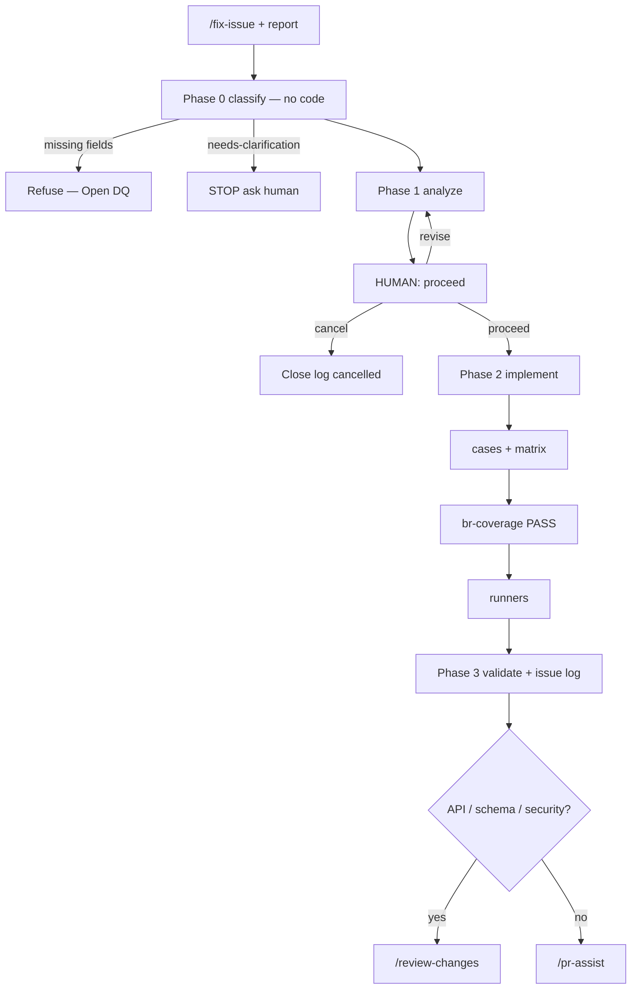

# 5. `/fix-issue` (reactive — not on the sprint spine)

Validated against: `/fix-issue`, rule 30 (production-fix governance).

Use for a bug, gap, or enhancement that is **not** already an approved sprint SP item. Do **not** put ad-hoc bugs on `/deliver-sprint`. Cited sprint diffs use `/apply-requirements` instead.

## Where it starts

Operator runs `/fix-issue` with a complete report. The locked execute spine never calls this command.

### Required inputs (refuse Phase 0 if missing)

| Field | Required |
|-------|----------|
| Issue summary (one-line what is wrong) | Yes |
| Expected behavior | Yes |
| Steps to reproduce | Yes for bugs (skip only for pure doc/config) |
| Actual behavior | Yes for bugs |
| Severity | Preferred: Critical / High / Medium / Low |

If Critical and production-impacting → confirm environment scope before implement.

**Loop:** Plan → Act → Validate → Refine (max 3) on analyze/implement. After analysis, **STOP** for proceed — that is a human gate, not a clarification round.

---

## Phase 0 — Classify (no production code)

Orchestrator classifies using the table below; records rationale in the orchestrator audit. Orchestrator does **not** write `artifacts/issues/**` (audit-only scope). The primary agent writes the issue log and copies the classification.

There is no triage agent and no `backend-fix-agent` / `frontend-fix-agent` peers.

Load before routing: accepted BRD, OpenAPI, feature notes, related code, recent audits.

| Classification | Route | Strong signals (first match wins; else full-stack) |
|----------------|--------|-----------------------------------------------------|
| backend | backend-agent mode `fix` | API stack trace; HTTP 4xx/5xx; wrong DB data; Flyway; service/repo/validator; OpenAPI/DTO; API auth/filter |
| frontend | frontend-agent mode `fix` | Layout/state/routing only; client validation; UI calls wrong but API OK in curl; UI proxy `/api` |
| full-stack | backend then frontend (both `fix`) | Contract mismatch; E2E broken across both; shared field semantics unclear |
| config-env | backend-agent (doc/env) or human | JDK/DB/proxy/`JAVA_HOME` — not app logic |
| needs-clarification | **STOP — ask human** | Cannot reproduce; expected contradicts BRD; bug vs enhancement unclear; missing AC |

Issue log (`artifacts/issues/<date>-<slug>.md`) must record: Classification, rationale (1–3 sentences citing signals), primary agent.

---

## Phase 1 — Analyze (still no implement)

Owning agent (mode `fix`):

| # | Step | Must |
|---|------|------|
| 1.1 | Reproduce or trace | Code, tests, logs, BRD, OpenAPI |
| 1.2 | Root cause | Not symptom only |
| 1.3 | Impact | Files, endpoints, schema, UI routes, tests at risk |
| 1.4 | Fix plan | Production-grade; reuse existing patterns; no workarounds (rule 30) |
| 1.5 | Stops | BRD/OpenAPI meaning change → STOP for PO; breaking API/schema → STOP for architect |
| 1.6 | Update issue log | Analysis sections complete |

Then **STOP**. Do not write production code.

---

## Human gate — proceed

Present the fix plan. Wait for explicit **"proceed"** (or equivalent).

| Human | Action |
|-------|--------|
| proceed / approved / yes | Phase 2 |
| revise / change plan | Update plan; **STOP** again |
| cancel / no | Close issue log as cancelled; audit only |

Agents **Must NOT** implement before **proceed**.

---

## Phase 2 — Implement (after proceed only)

Minimal diff. No temporary flags to hide bugs. No editing **applied** Flyway — add a new versioned file. Stay in `scope.yaml`.

| Area | Agent | Ordered substeps |
|------|-------|------------------|
| Backend | backend-agent mode `fix` | api-agent gate 2 verify/update → schema-migration-generator if DB → spring-module-generator → validation-chain-generator if cited validation BRs → test-case-generator → br-coverage-validator **PASS** → api-test-runner |
| Frontend | frontend-agent mode `fix` | mockup-to-component if layout → next-component-generator → test-case-generator → e2e-scenario-writer if journey changed → br-coverage-validator **PASS** → ui-test-runner |

Java after proceed: persist `artifacts/templates/<resource>-vars.yaml`; `tools/templates/render_check.py` PASS; do not rewrite controller style.

Implementers must not write `docs/test-cases-br-coverage.md`.

---

## Phase 3 — Validate and close

| # | Check | Evidence |
|---|-------|----------|
| 3.1 | New/changed unit tests | Case IDs in `docs/test-cases.md` + matrix |
| 3.2 | API regression | api-test-runner; `artifacts/test-results-<date>.md` |
| 3.3 | UI regression | ui-test-runner |
| 3.4 | E2E if user-facing journey changed | Playwright / e2e results |
| 3.5 | Issue log complete | `artifacts/issues/<date>-<slug>.md` |
| 3.6 | Audit | `artifacts/audit/<date>-fix-issue-<slug>.md` |
| 3.7 | Harness | phase-changing update |

---

## Next command

| Condition | Next |
|-----------|------|
| API, schema, auth, or security changed | `/review-changes` (needs `/run-eval` ledger — run `/run-eval` first if none) |
| Ready to open a PR | `/pr-assist` |
| Another unrelated issue | `/fix-issue` with a new report |
| Fix is actually sprint-sized | `/plan-sprint` or `/plan-governed-stories` |

---

## How this differs from the execute spine

| | `/implement-*` + expand + run-tests | `/fix-issue` |
|--|-------------------------------------|--------------|
| Trigger | Approved plan row | Ad-hoc report |
| Human gate | Plan Approved; later test-package Approved | **proceed** on the fix plan |
| Coverage PASS | Slice on implement; package on `/run-tests` | Slice for the **cited** fix rules after proceed |
| Batch | May run inside `/deliver-sprint` | **Never** inside `/deliver-sprint` |

Sprint delivery starts at [01-intake-and-planning.md](01-intake-and-planning.md).
