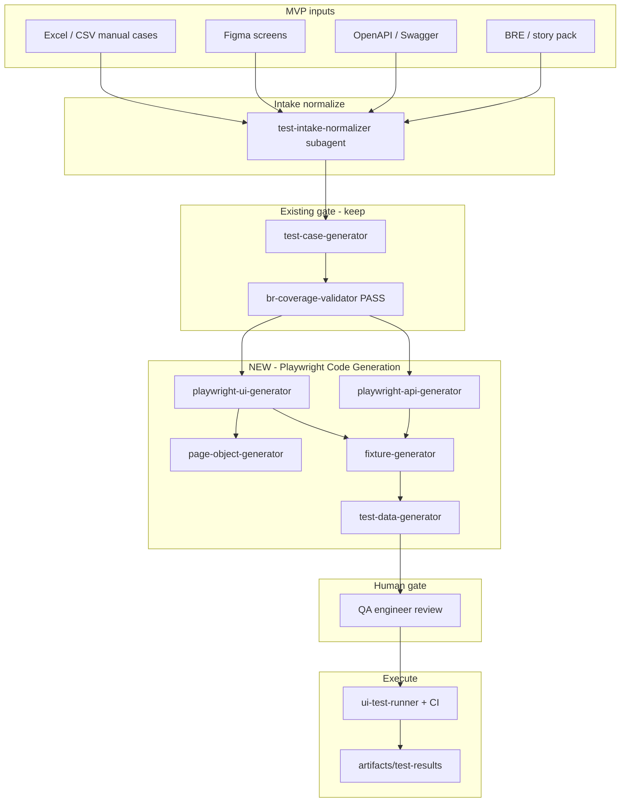
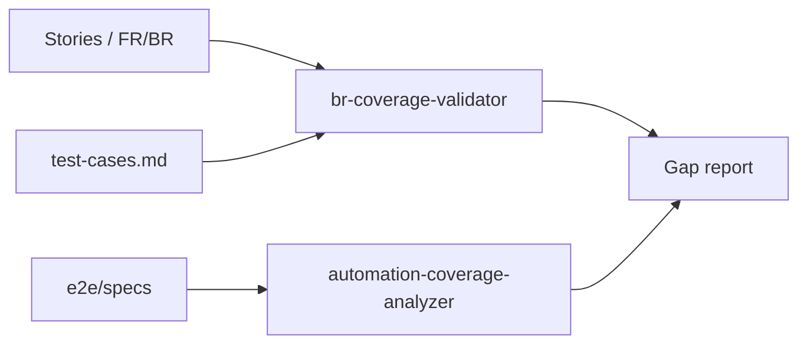

# Playwright AI Test Automation — MVP Plan

Design and implement an AI-assisted test automation framework built on Playwright that leverages Large Language Models (LLMs) and agent-based workflows to accelerate test creation. The framework generates production-quality Playwright test assets that can be reviewed, customized, and maintained by QA engineers, and integrates into existing CI/CD pipelines and enterprise SDLC practices.

---

## Executive summary

| Question | Answer |
|----------|--------|
| Can we plan this? | **Yes** — as a governed product capability on top of Playwright + the 19-agent factory |
| Does the factory already cover part of it? | **Partially** — design-first testing, BR coverage gate, Playwright skill, E2E subagent |
| What's missing for MVP? | **Playwright asset generation** (page objects, fixtures, test data), **multi-source intake** (Swagger, Figma, Excel/CSV), **QA review workflow**, **CI contract** |
| Future agents (self-heal, defect, coverage)? | **Plan now, build after MVP** — they depend on structured traces, baselines, and the asset model MVP establishes |

### Primary MVP objectives

Significantly reduce effort spent on:

1. **Initial test creation** — reviewed test suite based on current sprint goals/stories ready for execution before end of sprint
2. **Test maintenance** after UI changes
3. **Test data generation**

### Playwright Code Generation Agent (MVP)

Generate Playwright tests (one for API and one for UI) from requirements.

**Inputs:** BRE, API Swagger files, Figma screens, Excel/CSV manual test cases, etc.

**Outputs:**

- Page Objects
- Test Specs
- Fixture files
- Test Data

Also: create tests from existing manual test cases (Excel, CSV).

### Future vision (post-MVP)

| Agent | Capability |
|-------|------------|
| **Self-Healing Agent** | Analyze locator failures, compare previous DOM structure, suggest locator updates |
| **Defect Analysis Agent** | Failure summary, likely root cause, confidence score, suggested resolution |
| **Coverage Agent** | Requirements coverage, test coverage, gap analysis |

---

## How the MVP maps to the existing factory

The factory already enforces the right SDLC order:

```
Stories/BRD → test cases (md) → BR coverage PASS → scripts → execute → evals
```

That's exactly what `/expand-test-coverage` and **test-agent** (mode `generate`) do today:

```text
generate mode order (hard)
1. Design — test-case-generator + bdd-scenario-expander → docs/test-cases.md + docs/test-matrix.md
2. Coverage gate — quality-agent delegates br-coverage-validator (pre-script). FAIL → expand cases; do not script or run.
3. Scripts — template/agent generators for covered cases only
4. Execute — api-test-runner / ui-test-runner → artifacts/test-results*.md
```

Source: `.cursor/agents/test-agent.md`

### What exists today vs MVP

| MVP requirement | Today | Gap |
|-----------------|-------|-----|
| Playwright UI tests | `playwright-e2e` skill + `e2e-scenario-writer` | No page objects, fixtures, or test-data generators |
| API tests from Swagger | `test-case-generator` uses OpenAPI; JUnit via templates | No Playwright **API** request pattern / fixture layer |
| Input: BRD/stories | `evals.rule_source`, story pack | Already aligned |
| Input: Figma | Figma skills for **codegen**, not test locators | Need Figma → locator map / POM hints |
| Input: Excel/CSV manual cases | business-analyst-agent reads CSV for **stories** | Need manual-test-case → Playwright mapper |
| QA review before sprint end | BR coverage PASS + code-review | Need explicit **QA sign-off gate** on generated Playwright assets |
| CI/CD integration | `npm run test:e2e`, GitHub workflows via infra-agent | Need standard Playwright project layout + workflow template |
| Test data generation | Not first-class | New subagent + fixture pattern |

**Important constraint:** The factory forbids inventing journeys or AC not in sources (`e2e-scenario-writer`, rule 22). Generated Playwright code must trace to **BRE/story AC/OpenAPI/Figma/manual case row** — that is a feature, not a blocker.

---

## Recommended MVP architecture

Do not add a 20th primary agent (catalog lock). Extend **test-agent** with a new mode and specialist subagents:



### New public command (proposed)

**`/generate-playwright-suite`** (or extend `/expand-test-coverage` with flag `playwright: true`)

| Phase | Owner | Output |
|-------|-------|--------|
| 0 Normalize inputs | `test-intake-normalizer` (subagent) | `artifacts/test-intake/<date>-manifest.json` |
| 1 Design cases | test-agent → test-case-generator | `docs/test-cases.md`, `docs/test-matrix.md` |
| 2 Coverage gate | br-coverage-validator | `docs/test-cases-br-coverage.md` **PASS** |
| 3 Generate assets | playwright-* subagents | See asset layout below |
| 4 QA review | Human gate | Approved / changes requested |
| 5 Execute + CI | ui-test-runner | `artifacts/test-results*.md` |

---

## MVP asset layout (production-quality, maintainable)

Standardize under `${modules.ui}/` (from config):

```text
${modules.ui}/
  e2e/
    specs/           # *.spec.ts — one journey per AC cluster
    pages/           # Page Object Model
    fixtures/        # auth, apiContext, test harness
    data/            # JSON/TS factories (no secrets)
    helpers/         # waits, selectors, api clients
  playwright.config.ts
```

### Generation rules (governed)

- Every spec header cites `AC-xxx` / `TC-xxx` / manual case ID
- Page objects: role/test-id selectors first; CSS/XPath only when cited from Figma/manual case
- Fixtures: shared auth, base URL from env, API client from OpenAPI
- Test data: synthetic/factory pattern; PII masked; no hardcoded credentials
- Template-owned structure (mirror `java_test_templates/` → add `playwright_templates/`)

---

## Input → output matrix (MVP)

| Input | Used for | Generator |
|-------|----------|-----------|
| BRE / sprint stories | Scenarios, AC mapping | test-case-generator |
| OpenAPI / Swagger | API specs + contract negatives | playwright-api-generator |
| Figma (node URLs) | Locators, screen names, flows | page-object-generator + Figma MCP |
| Excel / CSV manual cases | Step mapping → specs | manual-case-importer (subagent) |

### Excel/CSV manual case schema (minimum columns)

`Case_ID`, `Title`, `Preconditions`, `Steps`, `Expected_Result`, `AC_ID`, `Priority`, `Type` (UI|API)

Importer produces matrix rows + case bodies; **does not** skip BR coverage gate.

---

## Sprint goal: reviewed suite ready before sprint end

Timeline aligned to the factory spine:

| Sprint week | Factory activity | Test automation MVP |
|-------------|------------------|---------------------|
| Sprint start | Plan **Approved**, stories ready | Run `/generate-playwright-suite` with story pack + Swagger + Figma refs |
| Mid-sprint | `/implement-api`, `/implement-ui` | Regenerate **delta** specs when UI/API changes (maintenance path) |
| Before sprint end | `/expand-test-coverage` | QA reviews generated assets; CI runs on PR |
| Sprint close | `/review-changes`, KPI | Coverage report + test-results artifact |

### Human gate for MVP

Generated Playwright code is **Draft — Pending QA Review** until a QA engineer approves (same pattern as BRD/plan gates). Store waiver/approval in `docs/harness/decisions.md` or `docs/quality/playwright-review-<sprint>.md`.

---

## CI/CD integration (enterprise SDLC)

MVP CI contract:

```yaml
# Conceptual — generated by infra-agent pattern
- job: playwright-e2e
  steps:
    - install deps
    - npx playwright install chrome  # or channel: chrome per playwright-e2e skill
    - npm run test:e2e
    - upload artifacts/test-results + playwright-report
```

### Quality gates in CI

1. `docs/test-cases-br-coverage.md` Status PASS (or block merge)
2. Playwright suite passes on target branch
3. No `# AMBIGUITY` / uncited scenarios in new specs
4. Secrets scan on fixtures/data

Hook into existing commands: `/implement-ui` already references `playwright-e2e` skill; `/expand-test-coverage` remains the batch path after features land.

---

## MVP scope vs out of scope

### In MVP (Phase 1–2)

- One **API** Playwright pattern (request fixture + spec per operation/group)
- One **UI** Playwright pattern (POM + spec per journey)
- Generate from: story pack + OpenAPI + Figma refs + CSV/Excel manual cases
- Page objects, fixtures, test data files
- QA review workflow + CI run
- Maintenance: re-run codegen on changed stories/OpenAPI/Figma with diff-friendly output

### Out of MVP (explicit defer)

- Self-healing locators
- Defect analysis agent
- Autonomous coverage gap closure
- Visual regression at scale
- Cross-browser matrix (start Chrome only, per existing skill note)

---

## Future vision — plan now, build later

These agents depend on MVP outputs (structured POMs, traces, baselines).

### 1. Self-Healing Agent (Phase 3)

| Trigger | Behavior |
|---------|----------|
| Locator failure in CI | Compare DOM snapshot vs last-known good; suggest `getByRole` / `testId` update |
| Inputs | Playwright trace, previous POM, Figma component map |
| Output | PR with locator diff + confidence score |
| Owner | test-agent mode `heal` — **human proceed** before merge |

### 2. Defect Analysis Agent (Phase 3)

| Trigger | Behavior |
|---------|----------|
| Test failure | Summarize failure, stack, screenshot, network log |
| Output | `artifacts/issues/<date>-e2e-failure.md` with root cause hypothesis + confidence |
| Integrates | `/fix-issue` reactive path |

### 3. Coverage Agent (Phase 2–3 bridge)

The factory already has **br-coverage-validator** for requirements ↔ test **cases**. Extend to:

| Layer | Tool |
|-------|------|
| Requirements coverage | br-coverage-validator (existing) |
| Code coverage | JaCoCo + Playwright coverage optional |
| **Automation coverage** | New subagent: maps `docs/test-matrix.md` → existing `e2e/specs` → gap report |
| Gap analysis | Output: `docs/quality/automation-coverage-<sprint>.md` |

This is **not** a new primary — **quality-agent** mode `coverage` coordinates.



---

## Agent / subagent catalog (respecting 19 primaries)

| Role | Implementation |
|------|----------------|
| Orchestration | `/generate-playwright-suite` → orchestrator → **test-agent** |
| Code generation | **Subagents** (new): `playwright-api-generator`, `playwright-ui-generator`, `page-object-generator`, `fixture-generator`, `test-data-generator`, `manual-case-importer`, `test-intake-normalizer` |
| Design + gates | Existing: test-case-generator, br-coverage-validator, ui-test-runner |
| Future heal/analyze | Subagents: `playwright-self-healer`, `e2e-defect-analyzer`, `automation-coverage-analyzer` |
| Observability | Tie to Factory Ops Hub — trace each generation run, drift if specs lack AC citation |

---

## MVP delivery phases

| Phase | Duration (indicative) | Deliverable |
|-------|----------------------|-------------|
| **0 — Foundation** | 1–2 weeks | `playwright_templates/`, folder convention, CI job template, intake manifest schema |
| **1 — API path** | 2 weeks | OpenAPI → API specs + fixtures; runs in CI |
| **2 — UI path** | 2–3 weeks | Figma + stories → POM + UI specs; QA review gate |
| **3 — Manual import** | 1–2 weeks | Excel/CSV → cases → Playwright (via existing case gate) |
| **4 — Sprint integration** | 1 week | Wire into `/expand-test-coverage` + sprint DoD |
| **5 — Maintenance** | Ongoing | Regenerate on UI/API change; diff review |

**Future:** Phase 6 self-heal, Phase 7 defect agent, Phase 8 full coverage agent.

---

## Risks and mitigations

| Risk | Mitigation |
|------|------------|
| LLM invents tests not in requirements | Mandatory BR coverage PASS + AC citation in every spec |
| Brittle selectors | POM + role/test-id policy; Figma → stable ids where possible |
| QA doesn't trust generated code | Human review gate; templates not raw LLM dumps |
| Three factories drift | Same command contract in `.cursor/`, `.claude/`, `.github/` twins |
| Secrets in test data | fixture-generator + secret-guard hooks (`.claude/hooks/secret-guard.mjs`) |

---

## Bottom line

1. **MVP:** Extend **test-agent** + new Playwright subagents + `/generate-playwright-suite`, keeping the existing **cases → BR PASS → scripts → run** gate.
2. **Outputs:** Page objects, specs, fixtures, test data — all traceable to sprint stories, Swagger, Figma, or manual cases.
3. **Sprint goal:** QA-reviewed, CI-runnable suite before sprint end.
4. **Future:** Self-healing, defect analysis, and coverage gap agents build on MVP assets, traces, and the existing **br-coverage-validator** / **quality-agent** coordination.

Related factory docs:

- [agent-regulatory-body-and-ops-hub.md](agent-regulatory-body-and-ops-hub.md)
- [external-platform-observability.md](external-platform-observability.md)
- [CURSOR-FLOW.md](../../CURSOR-FLOW.md) — execute spine including `/expand-test-coverage`
